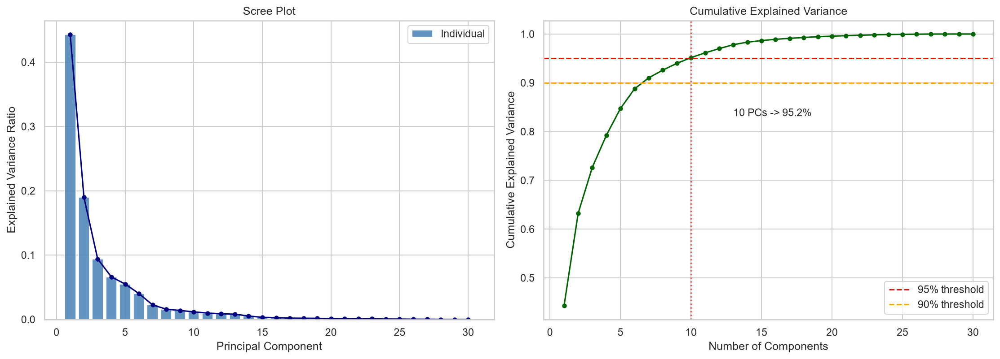
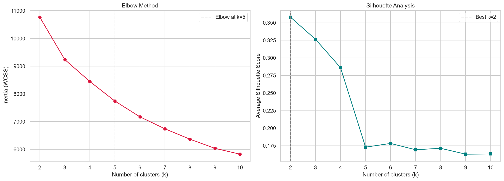
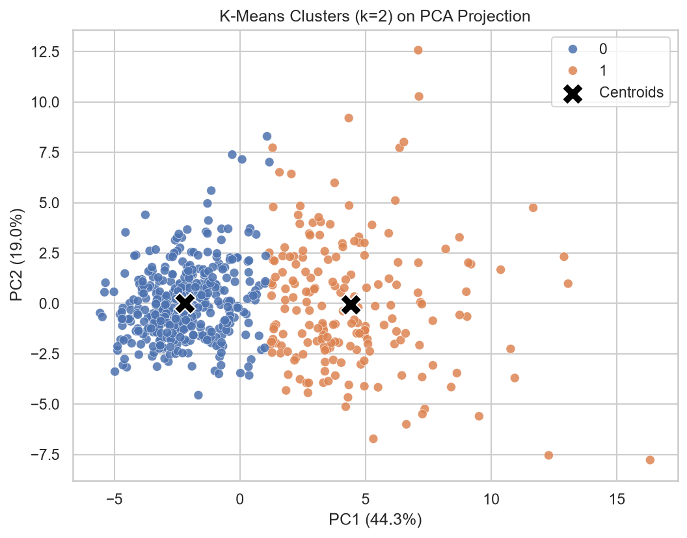
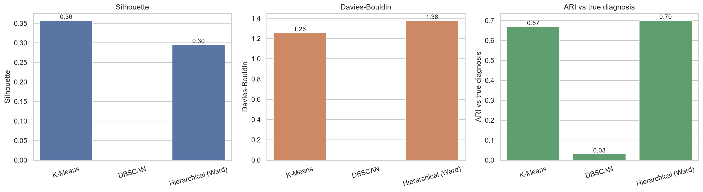

# Dimensionality Reduction & Unsupervised Clustering

Applying **Principal Component Analysis (PCA)** and three unsupervised clustering algorithms (**K-Means, DBSCAN, Hierarchical**) to discover patterns in high-dimensional data.

**Author:** Kiruthiga · [GitHub: kiruthigar2008](https://github.com/kiruthigar2008)

## Dataset
Breast Cancer Wisconsin (Diagnostic), built into `scikit-learn`: 569 samples, **30 numerical features**. No download is needed. The diagnosis label is *not* used for clustering, only for final validation.

## What the notebook does
1. Standardizes the 30 features (zero mean, unit variance)
2. Runs PCA and plots the **Explained Variance Ratio scree plot**. 10 components retain 95.2% of the variance
3. Interprets the components with a loadings heatmap
4. Finds the optimal k for K-Means with the **Elbow Method** and **Silhouette analysis**
5. Applies **DBSCAN** (k-distance plot, eps sweep) and **Hierarchical clustering** (dendrogram, linkage comparison)
6. Visualizes clusters in **2D (Seaborn)** and **interactive 3D (Plotly)**
7. Compares all models with Silhouette, Davies-Bouldin, Calinski-Harabasz and Adjusted Rand Index

## Key results

| Algorithm | Clusters | Noise | Silhouette | Davies-Bouldin | ARI vs diagnosis |
|---|---|---|---|---|---|
| K-Means (k=2) | 2 | 0 | 0.358 | 1.26 | 0.671 |
| DBSCAN | 1 | 36 | n/a | n/a | 0.032 |
| Hierarchical (Ward, k=2) | 2 | 0 | 0.296 | 1.38 | 0.702 |

* K-Means and Ward clustering recover the true benign and malignant groups reasonably well without ever seeing the labels.
* DBSCAN finds one dense core plus outliers. The two groups are not separated by a density gap, so it works better as an outlier detector here. The outliers it flags are about 61% malignant versus about 36% in the core.

## Visuals

| Scree plot | Elbow and Silhouette |
|---|---|
|  |  |

| K-Means clusters | Model comparison |
|---|---|
|  |  |

> The interactive 3D Plotly charts display in VS Code and Jupyter. GitHub does not render them, so static PNG versions of the other plots are saved in `images/`.

## How to run
```bash
python -m venv .venv
.venv\Scripts\activate        # Windows  (macOS/Linux: source .venv/bin/activate)
pip install -r requirements.txt
```
Open `PCA_Clustering_Project.ipynb` in VS Code, select the `.venv` kernel and click **Run All**.

## Project structure
```
pca-clustering-project/
├── PCA_Clustering_Project.ipynb   # main notebook (with outputs)
├── images/                        # saved plots (regenerated on each run)
├── requirements.txt
├── .gitignore
└── README.md
```

## Tech stack
Python · NumPy · Pandas · scikit-learn · SciPy · Matplotlib · Seaborn · Plotly
